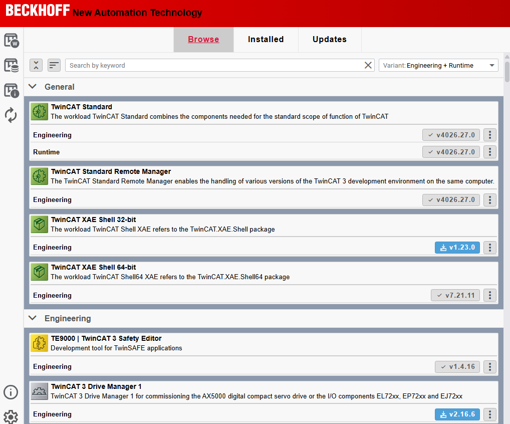
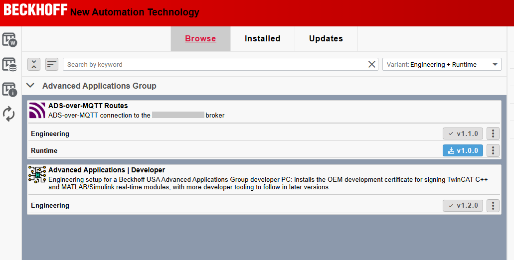
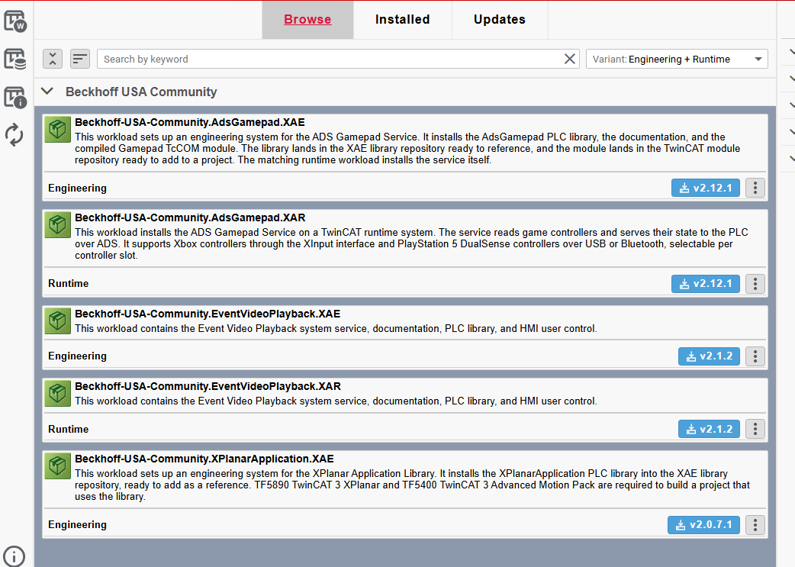

# Hosting packages

A feed is where the Package Manager finds packages. Beckhoff's own feeds come registered with the Package Manager. To hand your packages to other PCs, you put them on a feed of your own, and every PC that should see it registers it once with `tcpkg source add`.

This section covers three kinds of feed:

| Feed | What it is | Good for |
|---|---|---|
| [A folder on disk](folder.md) | a folder of `.nupkg` files, such as `C:\MyPackages` | testing, a single PC, a handover on a USB stick |
| [GitHub Packages](github.md) | the NuGet registry of a GitHub account or organization | packages you publish anyway, with your source on GitHub |
| [Nexus](nexus.md) | a Sonatype Nexus Repository server you run | a team or a company network, with the full GUI experience |

Nexus can also host packages for Beckhoff RT Linux and TwinCAT/BSD, and container images. That is outside the Package Manager, so it has a section of its own at the back: [self-hosting other packages](../self-hosting/index.md).

Whichever you pick, two things come first:

1. **Decide about [signature verification](signatures.md).** Your packages carry no Beckhoff signature, and the Package Manager refuses to install an unsigned package while verification is on. Either [sign your packages](signing.md) with a certificate of your own that every PC trusts once, or turn verification off on every PC that uses the feed.
2. **Decide where the icon and the release notes live.** That depends on the kind of feed, and it is the next section.

A feed can also show its terms before a PC registers it: a short text the user has to accept, the way Beckhoff's own testing feed and the Beckhoff USA Community feed do. That is a package of its own kind, the [feed disclaimer](../packages/disclaimer.md).

## Inside the package, or hosted next to the feed

A workload's icon and every package's release notes are files. Where the GUI looks for them depends on the feed:

* **From a folder feed, the GUI reads the files out of the package.** `<icon>icon.png</icon>` and `<readme>...ReleaseNote.md</readme>` in the nuspec are all it takes; the icon shows on the card and the release notes on the Feature Release Notes tab.
* **From a NuGet server, the GUI never sees a file inside the package.** A server such as Nexus or GitHub hands the Package Manager the nuspec metadata only: id, version, title, description, tags, dependencies, and URLs. The GUI then falls back to the stock icon, and the Feature Release Notes tab stays empty, although both files are in the package. Verified against Nexus with `tcpkg` 2.4, and still so with 2.6.

The way around is to host the two files at plain web addresses and point at them:

| File | Inside the package (folder feed) | Hosted next to the feed (NuGet server) |
|---|---|---|
| workload icon | `<icon>icon.png</icon>` | `<iconUrl>` in the nuspec, the address of a hosted copy of `icon.png` |
| release notes | `<readme>MyCompany....ReleaseNote.md</readme>` | a hosted copy of the file, at an address the feed's service index advertises; the nuspec has no field for it |

The release notes are the less obvious half. The nuspec has a `<releaseNotes>` field, but measured against Nexus it does not reach the Package Manager either. What the GUI uses instead is a URL template in the feed's service index, the `index.json` a feed is registered with: a resource of type `ReadmeUriTemplate/6.13.0` that tells it where to fetch the release notes of a given package and version. Beckhoff's feed advertises one. Nexus does not, so the [Nexus page](nexus.md#the-release-notes) shows how to add it.

Keep the files in the package as well. A package with `<icon>`, `<iconUrl>`, `<readme>` and a hosted copy of the release notes shows everything from either kind of feed.

## What the GUI shows from each feed

Beckhoff's feed, for comparison. Workloads with the same title are one card with an Engineering and a Runtime row, and every card has its own icon:

A Nexus feed with hosted icons and a hosted service index. The two ADS-over-MQTT workloads share one title and show as one card with two rows, with their own icon; the release notes show on the Feature Release Notes tab:

A GitHub feed. The category from the tags works, but every card shows the package id instead of the title, the Engineering and Runtime workloads of one product are two cards, and the icons are the stock ones:

The [GitHub page](github.md#what-works-and-what-does-not) has more on that.
